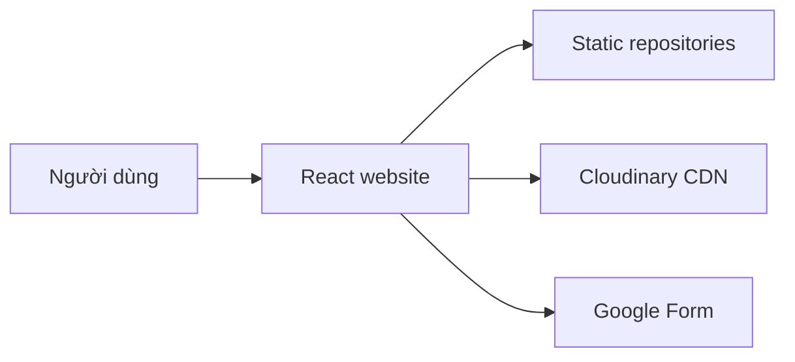
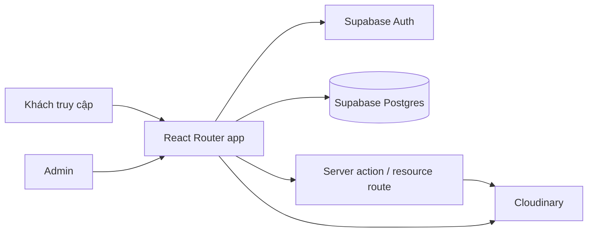
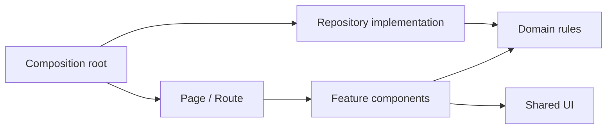

# Đề xuất kiến trúc và định hướng UI

> Phiên bản: 1.0  
> Ngày cập nhật: 13/09/2026  
> Nguồn yêu cầu: `docs/PRODUCT_SPECIFICATION.md`

## 1. Quyết định tổng quát

Kiến trúc phù hợp nhất với quy mô hiện tại là:

1. **Modular Monolith** ở cấp hệ thống.
2. **Feature-first / Vertical Slice** để tổ chức source frontend.
3. **Clean boundaries** trong từng feature: domain, data và UI không trộn lẫn.
4. **Repository Pattern** để V1 dùng dữ liệu tĩnh và V1.1 chuyển sang API mà không viết lại page/component.
5. **Policy/Strategy dạng hàm thuần** cho trạng thái, CTA và sắp xếp hoạt động.
6. **Design System theo tầng**: design tokens → UI primitives → domain components → page sections.

Không nên dùng microservices cho sản phẩm này. Số lượng tính năng, admin và lưu lượng dự kiến chưa tạo ra lợi ích tương xứng với chi phí triển khai, logging, xác thực và đồng bộ dữ liệu giữa nhiều service.

## 2. Kiến trúc hệ thống đề xuất

### 2.1. V1



- React + TypeScript tiếp tục là nền tảng giao diện.
- Dữ liệu About, Staff và Activity nằm trong các file dữ liệu có kiểu rõ ràng.
- Repository trả `Promise` ngay cả khi đọc dữ liệu tĩnh, giúp giao diện không phụ thuộc vào nguồn dữ liệu.
- Cloudinary tiếp tục phân phối hình ảnh.
- Google Form xử lý đăng ký ngoài hệ thống.

### 2.2. V1.1



Stack được đề xuất cho V1.1:

- **React Router Framework Mode** cho route module, loader/action, error boundary, metadata và lựa chọn pre-render/SSR.
- **Supabase Postgres** cho Activities, Media metadata và Admin profile.
- **Supabase Auth email/password**, tắt đăng ký công khai và tạo trước 2–3 tài khoản admin.
- **Row Level Security** để khách chỉ đọc nội dung `PUBLISHED`, còn admin đã xác thực được quản lý dữ liệu.
- **Cloudinary signed upload** qua code chạy phía server; API secret không xuất hiện trong browser.

Supabase ở đây thay phần tự xây password storage, session infrastructure và database administration. Đây vẫn là tài khoản/mật khẩu riêng của website, không yêu cầu tài khoản Google.

### 2.3. Rendering và hosting

Repo hiện dùng `HashRouter` để tương thích GitHub Pages. Cách này phù hợp để demo nhưng không thỏa tốt ba yêu cầu đã chốt: URL dạng `/activities/:slug`, SEO theo từng trang và Open Graph theo từng hoạt động.

Lộ trình khuyến nghị:

- Trong lúc làm V1: có thể giữ `HashRouter` để không mở rộng phạm vi quá sớm.
- Trước bản production: chuyển sang clean URL và hosting hỗ trợ route fallback hoặc pre-render.
- Với dữ liệu tĩnh V1: pre-render `/`, `/about`, `/staff`, `/activities` và toàn bộ slug hoạt động ở build time.
- Với V1.1: dùng SSR cho landing page động, hoặc kích hoạt build mới sau mỗi lần admin xuất bản. SSR cho trải nghiệm xuất bản tức thời; rebuild rẻ hơn về vận hành nhưng nội dung không xuất hiện cho tới khi build hoàn tất.

Khuyến nghị cuối cùng là **React Router Framework Mode + SSR** khi bước vào V1.1. Framework Mode vẫn dựa trên Vite và React Router đang có, nên ít lệch khỏi nền tảng hiện tại hơn việc chuyển toàn bộ sang framework khác.

## 3. Pattern frontend

### 3.1. Cấu trúc thư mục mục tiêu

```text
src/
├── app/
│   ├── layouts/
│   │   ├── PublicLayout.tsx
│   │   └── AdminLayout.tsx
│   ├── providers/
│   ├── router/
│   └── styles/
│       ├── tokens.css
│       ├── globals.css
│       └── utilities.css
├── features/
│   ├── about/
│   │   ├── data/
│   │   ├── components/
│   │   ├── pages/
│   │   └── index.ts
│   ├── activities/
│   │   ├── domain/
│   │   │   ├── activity.types.ts
│   │   │   ├── activity.repository.ts
│   │   │   ├── activity-status.policy.ts
│   │   │   └── activity-sort.policy.ts
│   │   ├── data/
│   │   │   ├── static-activity.repository.ts
│   │   │   └── supabase-activity.repository.ts
│   │   ├── components/
│   │   ├── pages/
│   │   └── index.ts
│   ├── staff/
│   │   ├── domain/
│   │   ├── data/
│   │   ├── components/
│   │   ├── pages/
│   │   └── index.ts
│   ├── media/                    # V1.1
│   └── auth/                     # V1.1
├── shared/
│   ├── ui/
│   ├── hooks/
│   ├── lib/
│   ├── config/
│   ├── types/
│   └── assets/
└── main.tsx
```

### 3.2. Quy tắc phụ thuộc



- `domain` không import React, router, Supabase hoặc Cloudinary.
- `data` triển khai interface do `domain` định nghĩa.
- `components` nhận dữ liệu đã có kiểu và không tự gọi SDK hạ tầng.
- `pages/routes` điều phối loader, filter state, empty/error state và composition.
- `shared` không import ngược từ `features`.
- Feature khác chỉ import từ `features/<name>/index.ts`, không đi xuyên vào file nội bộ.
- `app` là composition root: chọn static repository ở V1 hoặc Supabase repository ở V1.1.

### 3.3. Repository Pattern

Interface chỉ mô tả nhu cầu thật của màn hình, không tạo `BaseRepository<T>` tổng quát.

```ts
export interface ActivityRepository {
  list(query?: ActivityQuery): Promise<ActivitySummary[]>;
  getBySlug(slug: string): Promise<Activity | null>;
}
```

V1:

```ts
export const staticActivityRepository: ActivityRepository = {
  async list(query) {
    return filterAndSortActivities(activityFixtures, query);
  },
  async getBySlug(slug) {
    return activityFixtures.find((item) => item.slug === slug) ?? null;
  },
};
```

V1.1 thay implementation bằng Supabase/API, trong khi `ActivitiesPage`, `ActivityDetailPage` và các component không đổi hợp đồng.

### 3.4. Policy cho trạng thái hoạt động

Không tính trạng thái rải rác trong card, landing page và admin. Dùng một hàm thuần duy nhất:

```ts
export function resolveActivityStatus(
  activity: ActivitySchedule,
  now: Date,
): ActivityTemporalStatus;
```

Các policy độc lập nên có:

- `resolveActivityStatus(activity, now)`.
- `resolveActivityCta(activity, status)`.
- `sortActivities(activities, now)`.
- `filterActivities(activities, query, now)`.
- `validateActivityForPublish(activity)`.

Truyền `now` từ ngoài vào thay vì gọi `new Date()` bên trong giúp unit test ổn định và kiểm tra chính xác các mốc thời gian.

### 3.5. Route và data loading

Ở trạng thái hiện tại, route có thể tiếp tục dùng Declarative Mode. Khi bắt đầu route động và SEO, chuyển dần sang route objects/route modules:

- Loader lấy dữ liệu trước khi render trang.
- `ErrorBoundary` xử lý lỗi theo route.
- Pending UI dùng skeleton tương ứng với layout thật.
- Route `/activities/:slug` trả Not Found khi repository trả `null`.
- Admin route dùng layout và guard riêng.

Không đặt toàn bộ server state vào một Context toàn cục. Theme và session phù hợp với provider; danh sách hoạt động phù hợp với loader/repository.

## 4. Pattern backend V1.1

### 4.1. Modular Monolith/BFF

Backend được chia module logic nhưng triển khai cùng một ứng dụng:

```text
server/
├── auth/
├── activities/
├── media/
├── shared/
└── db/
```

Mỗi module sở hữu validation, authorization và truy cập dữ liệu của mình. Không cho UI gọi trực tiếp Cloudinary Admin API hoặc dùng Supabase secret key.

### 4.2. Xác thực

- Dùng Supabase Auth email/password.
- Tắt public sign-up; admin do người phụ trách tạo trước.
- Bảng `admin_profiles` liên kết với Auth user và có cờ `active`.
- Tất cả admin hiện có cùng role `ADMIN`.
- Route/action quản trị kiểm tra cả phiên hợp lệ và `admin_profiles.active = true`.
- Khi một người rời ban quản trị, vô hiệu hóa profile/session thay vì chỉ xóa menu.

### 4.3. RLS tối thiểu

- Khách (`anon`) chỉ được `SELECT` activity có `content_status = 'PUBLISHED'`.
- Người đã xác thực không tự động có quyền admin; phải tồn tại trong `admin_profiles` đang hoạt động.
- Chỉ admin được insert/update/archive activity và media metadata.
- Secret/service key chỉ tồn tại ở server.
- Policy và grant đều phải được kiểm thử; chỉ bật RLS nhưng để grant quá rộng là chưa đủ.

### 4.4. Cloudinary upload

Luồng đề xuất:

1. Admin chọn ảnh ở Media Library.
2. Client gửi yêu cầu xin chữ ký kèm folder/mục đích sử dụng.
3. Server xác thực admin và chỉ cho phép tập tham số đã định trước.
4. Server tạo signature ngắn hạn.
5. Browser upload trực tiếp lên Cloudinary để không truyền file lớn qua app server.
6. Client gửi kết quả upload về server.
7. Server kiểm tra và lưu `public_id`, URL, kích thước, định dạng, alt text và người tạo.

Không dùng unsigned upload ở trang quản trị production vì preset có thể bị lấy từ browser và bị lạm dụng để tải file ngoài ý muốn.

## 5. Design System

### 5.1. Hướng thị giác

Định hướng: **Technology Editorial** — hiện đại, rõ thông tin và có năng lượng công nghệ, nhưng vẫn giống một tổ chức sinh viên đáng tin cậy hơn là dashboard SaaS.

Các yếu tố giữ từ branding hiện tại:

- Navy đậm làm nền và màu tin cậy.
- Cyan/aqua làm điểm nhấn và thể hiện công nghệ.
- Gradient xanh từ logo chỉ dùng ở hero, CTA quan trọng hoặc điểm nhấn lớn.
- `Space Grotesk` cho display heading.
- `Be Vietnam Pro` cho nội dung tiếng Việt.
- Hỗ trợ đồng đều light và dark mode.

### 5.2. Token màu đề xuất

| Token | Light | Dark | Mục đích |
| --- | --- | --- | --- |
| `surface-page` | `#F7FAFC` | `#071522` | Nền trang. |
| `surface-section` | `#FFFFFF` | `#0A1929` | Section/card lớn. |
| `surface-elevated` | `#FFFFFF` | `#0D2137` | Card nổi. |
| `text-primary` | `#08233E` | `#F7FCFF` | Nội dung chính. |
| `text-secondary` | `#52677B` | `#B8C9D9` | Nội dung phụ. |
| `brand-navy` | `#023263` | `#8FCBFF` | Nhận diện chính. |
| `brand-cyan` | `#087F9C` | `#50F8F7` | CTA/focus/điểm nhấn. |
| `border-subtle` | `#DCE8F0` | `#1E4059` | Viền phân tách. |
| `status-success` | `#087A55` | `#54E1AC` | Đang mở/hoàn tất phù hợp. |
| `status-warning` | `#9A5A00` | `#FFD27D` | Sắp mở/sắp diễn ra. |
| `status-danger` | `#B42318` | `#FFAAA3` | Đã hủy/lỗi. |

Không dùng cyan sáng làm chữ nhỏ trên nền trắng; token cyan light được làm đậm để đảm bảo tương phản.

### 5.3. Typography

- Display/H1: Space Grotesk, 700, responsive 40–64 px.
- H2: Space Grotesk, 700, 30–44 px.
- H3: Space Grotesk hoặc Be Vietnam Pro, 600–700, 20–28 px.
- Body: Be Vietnam Pro, 400, 16–18 px.
- Supporting text: tối thiểu 14 px.
- Dòng nội dung dài giới hạn khoảng 65–75 ký tự để dễ đọc.

### 5.4. Spacing và hình khối

- Base spacing: 4 px; khoảng cách phổ biến 8, 12, 16, 24, 32, 48, 64 và 96 px.
- Container công khai: tối đa 1200–1280 px.
- Nội dung bài dài: tối đa 720–780 px.
- Card radius: 20–24 px cho card truyền thông; 12–16 px cho control và admin.
- Button cao tối thiểu 44 px.
- Shadow nhẹ; không dùng shadow lớn cho mọi card.
- Hover chỉ bổ trợ. Nội dung và CTA phải rõ khi không hover.

## 6. Component pattern

### 6.1. Tầng 1 — Primitives

```text
Button
IconButton
LinkButton
Badge
Input
Select
Tabs
Accordion
Avatar
ResponsiveImage
Container
Section
Divider
Skeleton
```

Quy tắc:

- Mỗi primitive có API nhỏ, typed props và các variant hữu hạn.
- Không truyền `isDark` xuống component. Màu lấy từ CSS semantic tokens.
- Button dùng các variant `primary`, `secondary`, `ghost`, `danger`; không nhận chuỗi class tùy ý cho mọi trường hợp.
- Component tương tác phải giữ semantic HTML và focus state.

### 6.2. Tầng 2 — Domain components

```text
ActivityCard
ActivityStatusBadge
ActivityFilterBar
ActivityQuickFacts
ActivityCta
StaffNode
OrganizationTree
TeamRoster
TermSelector
DepartmentCard
ImageGallery
MediaPicker
PublishStatusControl
```

Domain component biết kiểu dữ liệu của feature nhưng không tự tải dữ liệu.

### 6.3. Tầng 3 — Page sections

```text
AboutHero
MissionVisionSection
CoreValuesSection
DepartmentsSection
UpcomingActivitiesSection
PastActivitiesSection
ActivityHero
ActivityAgendaSection
ActivityResultsSection
StaffOrganizationSection
StaffTeamsSection
```

Page section kết hợp primitives và domain components. Route/page chỉ quyết định thứ tự section, dữ liệu và state cấp trang.

### 6.4. Theme pattern

Hiện tại nhiều component gọi `useTheme()` rồi lặp điều kiện class cho dark/light. Cách này sẽ khó duy trì khi số trang tăng.

Mục tiêu refactor:

- `ThemeProvider` chỉ thêm/bỏ class `dark` trên root và lưu preference.
- Tạo semantic CSS variables cho background, text, border, accent và status.
- Component dùng class semantic như `bg-surface-elevated`, `text-primary`, `border-subtle`.
- Chỉ `ThemeToggle` cần biết action đổi theme; component nội dung không cần đọc `isDark`.

## 7. Thiết kế từng trang

### 7.1. Trang Giới thiệu

```text
[Page hero: ảnh lớn + “Chúng tôi là ai”]
[Đoạn giới thiệu ngắn, tối đa 2–3 đoạn]
[Sứ mệnh] [Tầm nhìn]
[Giá trị cốt lõi: 3–4 cards]
[Ban Technical] [Ban Operation]
[Image mosaic 1 ảnh lớn + 3 ảnh nhỏ]
[CTA: Khám phá hoạt động]
```

- Hero không cao toàn màn hình để tránh lặp lại trang chủ.
- Mission/Vision dùng hai card cân bằng; Core Values dùng icon nhỏ và nội dung ngắn.
- Hai ban dùng card ngang có ảnh, mô tả và các từ khóa vai trò tổng quát.
- Ảnh là nội dung chính, không dùng icon lớn thay ảnh CLB.

### 7.2. Trang Nhân sự

```text
[Heading + mô tả]                [Nhiệm kỳ 2025–2026 ▾]

                         [Chủ nhiệm]
                ┌────────────┼────────────┐
[PCT/Technical]      [Thư ký–Thủ quỹ]      [PCT/Operation]
       │                                          │
[Thành viên ban]                           [Thành viên ban]

[Các team cấp CLB]
[AI] [Web] [Game] [Mobile]
```

- Desktop dùng đường nối mảnh và node nổi trên nền section.
- Phó chủ nhiệm hiển thị hai dòng chức vụ, không gộp thành chuỗi quá dài.
- Thành viên ban dùng card nhỏ hơn Ban chủ nhiệm.
- Mobile bỏ đường cây ngang, dùng heading theo cấp và danh sách card dọc/2 cột.
- Team roster tách riêng vì thành viên có thể thuộc bất kỳ ban nào.

### 7.3. Trang Hoạt động

```text
[Heading + mô tả]
[Filter loại] [Filter trạng thái] [Filter năm]

Sắp diễn ra
[Featured card lớn] [Featured card lớn]

Đã diễn ra
[Card] [Card] [Card]
```

- Featured card dùng tỷ lệ ảnh 16:9, nhãn trạng thái rõ và CTA “Xem chi tiết”.
- Past card gọn hơn nhưng vẫn hiển thị ngày và loại.
- Filter sử dụng select trên mobile; có thể dùng segmented buttons khi đủ chiều rộng.
- Không dùng carousel cho danh sách chính vì người dùng cần quét và so sánh nhiều hoạt động.

### 7.4. Landing page hoạt động

```text
[Breadcrumb]
[Ảnh cover]
[Status + category]
[Tên hoạt động]
[Mô tả ngắn]
[Thời gian] [Địa điểm] [Đối tượng]
[CTA đăng ký/kết quả]

[Main content 2/3]                  [Sticky summary 1/3]
Giới thiệu                         Thời gian
Chương trình                       Địa điểm
Diễn giả/BTC                       Hạn đăng ký
Quyền lợi/Thể lệ                   CTA
FAQ
Kết quả + Gallery
```

- Trên mobile, summary đặt ngay sau hero và không sticky.
- CTA chính xuất hiện gần tiêu đề và trong summary; không lặp quá hai lần.
- Section không có dữ liệu tự ẩn.
- Nội dung kết quả chỉ xuất hiện khi có dữ liệu, không để heading rỗng.

### 7.5. Admin Activities

- Layout sidebar đơn giản, ưu tiên công việc hơn hiệu ứng branding.
- Danh sách có tiêu đề, trạng thái nội dung, trạng thái thời gian, thời gian cập nhật và action menu.
- Form hoạt động chia thành nhóm: Cơ bản, Lịch trình, Đăng ký, Nội dung, Kết quả, Media, SEO.
- Có thanh hành động sticky: Lưu nháp, Xem trước, Xuất bản.
- Validation đặt cạnh field và có summary khi bấm xuất bản.
- Không dùng một form modal lớn; route riêng dễ lưu nháp và tránh mất dữ liệu.

### 7.6. Admin Media

- Toolbar gồm Upload, tìm kiếm và filter folder/trạng thái.
- Grid thumbnail đồng nhất, có multi-select.
- Side panel hiển thị preview, alt text, metadata và nơi đang sử dụng.
- Nút xóa vĩnh viễn chỉ bật khi số tham chiếu bằng 0.
- “Lưu trữ” là action mặc định; “Xóa vĩnh viễn” nằm trong khu vực nguy hiểm.

## 8. Responsive pattern

| Kích thước | Quy tắc chính |
| --- | --- |
| 320–639 px | Một cột; filter dùng select; cây nhân sự thành nhóm dọc; CTA full-width khi cần. |
| 640–1023 px | Grid 2 cột; node nhân sự thu gọn; navigation tablet. |
| Từ 1024 px | Container rộng; grid 3 cột; cây tổ chức đầy đủ; landing page 2/3 + 1/3. |

Không dựa hoàn toàn vào breakpoint cố định: card grid dùng `minmax()` hoặc container query khi component được tái sử dụng ở sidebar/admin.

## 9. Testing strategy

### 9.1. Unit

- Tính trạng thái ở đúng từng biên thời gian.
- Manual override.
- CTA theo trạng thái và kết quả.
- Sắp xếp upcoming/past.
- Validation khi xuất bản.
- Mapping cây nhân sự và thành viên nhiều chức vụ.

### 9.2. Component

- ActivityCard ở mọi trạng thái.
- Filter bar và empty state.
- Term selector.
- Staff tree desktop/mobile.
- Activity form validation.
- Media asset đang/không đang được tham chiếu.

### 9.3. End-to-end

- Người dùng tìm hoạt động và mở Google Form.
- Người dùng xem kết quả hoạt động đã kết thúc.
- Đổi nhiệm kỳ nhân sự.
- Admin đăng nhập, tạo nháp, preview và publish.
- Admin upload ảnh và chọn làm cover.
- Người không có quyền không truy cập được admin/API ghi dữ liệu.

## 10. Kế hoạch migration

### Giai đoạn A — Nền móng

1. Chốt semantic tokens và global styles.
2. Tạo `shared/ui` với Button, Badge, Container, Section và ResponsiveImage.
3. Thêm alias import và boundary lint rule nếu cần.
4. Giữ nguyên UI trang chủ trong quá trình tách component.

### Giai đoạn B — Domain và dữ liệu V1

1. Tạo feature `activities`, types và status/sort policies.
2. Tạo static repository và dữ liệu mẫu có validation.
3. Tạo feature `staff` với dữ liệu nhiệm kỳ và assignment.
4. Chuyển `intro.service.ts`, `team.service.ts`, `faq.service.ts` về đúng feature/data thay vì gọi dữ liệu tĩnh là service.

### Giai đoạn C — UI công khai

1. Hoàn thiện Activities list.
2. Hoàn thiện Activity landing page.
3. Hoàn thiện Staff.
4. Hoàn thiện About.
5. Đồng bộ states, responsive và accessibility.

### Giai đoạn D — Routing/SEO

1. Thêm route động và Not Found thật thay vì trả HomePage cho mọi route lạ.
2. Chuyển khỏi hash URL trước production.
3. Bổ sung metadata và pre-render cho V1.
4. Chọn deployment hỗ trợ clean URL/SSR cho V1.1.

### Giai đoạn E — Admin V1.1

1. Tạo Supabase schema, migration, Auth và RLS.
2. Thêm AdminLayout/Login.
3. Thay static activity repository bằng Supabase implementation.
4. Xây Activity editor và preview/publish flow.
5. Tích hợp signed upload Cloudinary và Media Library.
6. Bổ sung audit, backup và kiểm thử quyền.

## 11. Những việc không nên làm

- Không tạo một thư mục `components` khổng lồ chứa mọi component không phân domain.
- Không để page trực tiếp gọi Cloudinary/Supabase SDK.
- Không lặp logic trạng thái trong nhiều component.
- Không hard-code dark/light class cho từng phần tử mới.
- Không tạo abstraction tổng quát trước khi có ít nhất hai trường hợp thật sự dùng chung.
- Không xây microservices, Redux toàn cục hoặc CMS tùy biến đầy đủ cho V1.
- Không đổi toàn bộ repo trong một pull request; migration theo feature giúp kiểm soát regression.

## 12. Kết luận kiến trúc

Pattern chính được chọn là **Feature-first Modular Monolith kết hợp Repository Pattern và domain policy thuần**. Nó đủ đơn giản cho nhóm sinh viên triển khai, nhưng đã chuẩn bị đường chuyển từ dữ liệu tĩnh sang Supabase/Cloudinary mà không buộc viết lại UI.

Thứ tự triển khai tốt nhất là: design tokens và primitives → Activities domain/UI → Staff → About → routing/SEO → Admin. Activities nên đi trước vì đây là mục tiêu sản phẩm quan trọng nhất và cũng kiểm chứng gần như toàn bộ pattern dữ liệu, trạng thái, route động và component.

## 13. Tài liệu kỹ thuật tham khảo

- React Router mô tả Framework Mode có route module, data loading, code splitting và nhiều chiến lược rendering: <https://reactrouter.com/start/modes>
- React Router hỗ trợ pre-render route tĩnh và route động được liệt kê ở build time: <https://reactrouter.com/how-to/pre-rendering>
- Supabase Auth hỗ trợ email/password và tích hợp với RLS: <https://supabase.com/docs/guides/auth>
- Supabase cho phép tắt sign-up để chỉ tài khoản có sẵn đăng nhập: <https://supabase.com/docs/guides/auth/general-configuration>
- Supabase yêu cầu bảo vệ bảng được expose bằng grants và Row Level Security: <https://supabase.com/docs/guides/database/postgres/row-level-security>
- Cloudinary khuyến nghị signed upload khi cần quy trình upload được bảo vệ; chữ ký được tạo phía server: <https://cloudinary.com/documentation/upload_widget>
